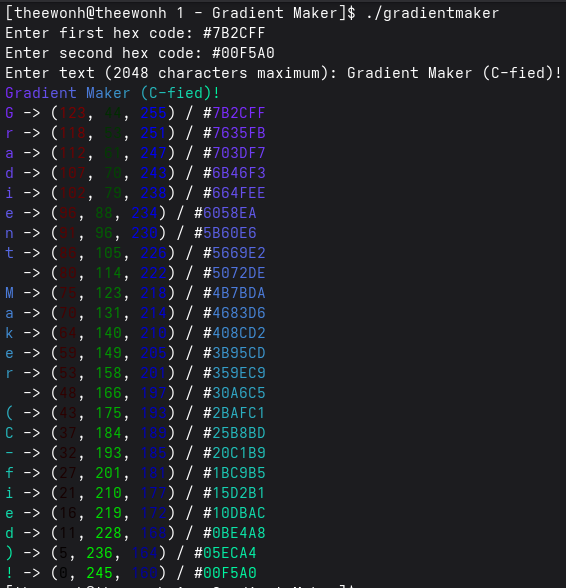

# Gradient Maker (C)

A simple program that applies a color gradient to text using as little code as possible.

#### Originally written in Python, this project was rewritten in C as part of my journey learning a new programming language.

## Usage

### Requirements

- A C compiler, such as GCC
- A terminal with ANSI 24-bit truecolor support

### Compilation

**Unix-like systems (Linux, macOS):**

    gcc gradientmaker.c -o gradientmaker -lm

**Windows:**

    gcc gradientmaker.c -o gradientmaker.exe -lm

### Running

**Unix-like systems (Linux, macOS):**

    ./gradientmaker

**Windows:**

    gradientmaker.exe
