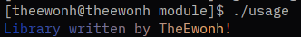

# Gradient Maker (C)


A simple program that applies a color gradient to text using as little code as possible.

#### Originally written in Python, this project was rewritten in C as part of my journey learning a new programming language.

## Usage

### Requirements

- A C compiler, such as GCC
- A terminal with ANSI 24-bit truecolor support

### Compilation

**Unix-like systems (Linux, macOS):**
```bash
gcc gradientmaker.c -o gradientmaker -lm
```

**Windows:**
```bash
gcc gradientmaker.c -o gradientmaker.exe -lm
```

## Usage as library


*See [guide](./module/usage.c) how to use this library*
### Compilation
**Unix-like systems (Linux, macOS):**
```bash
gcc yourProject.c gradientMaker.c -o yourProject -lm
```
**Windows:**
```bash
gcc yourProject.c gradientMaker.c -o yourProject.exe -lm
```

## Running

**Unix-like systems (Linux, macOS):**

    ./gradientmaker

**Windows:**

    gradientmaker.exe

#### NOTE:
This project is still work in progress. I'm learning C, so bugs and improvements are expected. Contributions and feedback are welcome!
